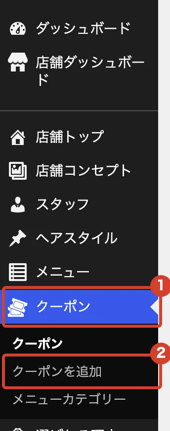
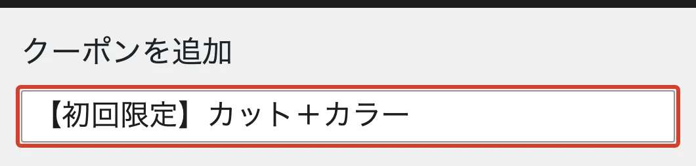
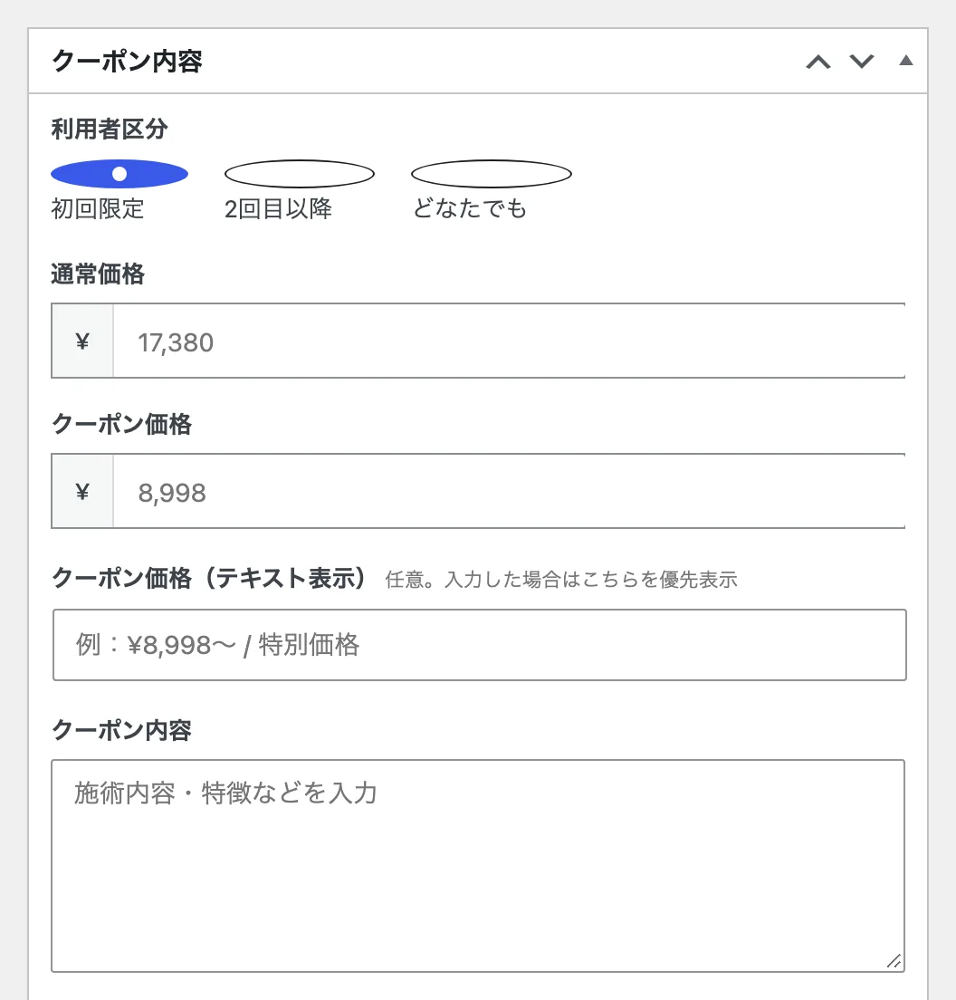
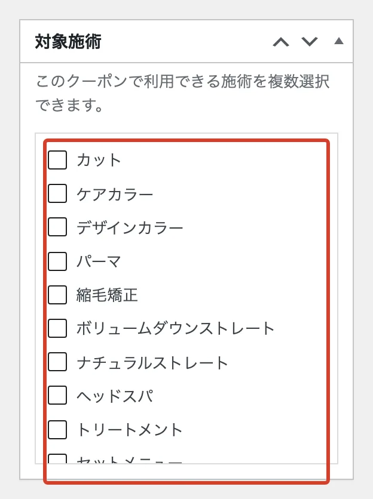
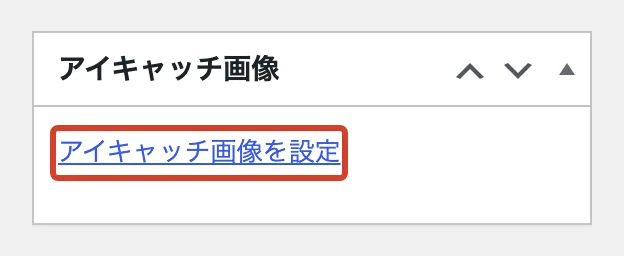

# クーポンを載せたい

ホームページの「クーポン」ページにクーポンを載せます。

<ol class="steps" markdown>
<li markdown="block">
左のメニューで「クーポン」→「クーポンを追加」を押します。

{ .shot }
</li>
<li markdown="block">
いちばん上の欄に、クーポン名を入れます。

{ .shot }
</li>
<li markdown="block">
「クーポン内容」に入れます。

- 「利用者区分」で、初回限定・2回目以降・どなたでも から選びます。
- 「通常価格」と「クーポン価格」に数字を入れます。
- 「クーポン内容」に、施術の内容を書きます。
- 枠のいちばん下の「表示順」は、小さい数字ほど上に並びます。

ほかの欄は空欄でもかまいません。

{ .shot }
</li>
<li markdown="block">
右側の「対象施術」で、当てはまるものにチェックを入れます。

{ .shot }
</li>
<li markdown="block">
写真を出すときは、右下の「アイキャッチ画像を設定」で選びます。

{ .shot }
</li>
<li markdown="block">
右上の「公開」を押します。
</li>
</ol>

!!! note "期間が終わったクーポン"
    [非公開にする](unpublish.md)と、ホームページから消えます。あとでまた使うときに便利です。
