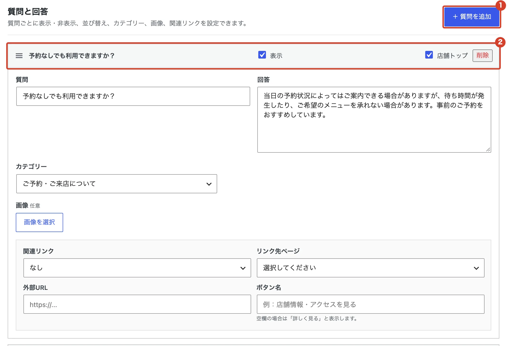
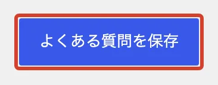

# よくある質問を変えたい

ホームページの「よくある質問」ページの質問と回答を、追加・変更します。

<ol class="steps" markdown>
<li markdown="block">
左のメニューの「FAQ」を開きます。
</li>
<li markdown="block">
「質問と回答」で、質問を直すか、「＋ 質問を追加」で新しく足します。

1. 「＋ 質問を追加」
2. 「表示」を外すとホームページに出なくなります。「店舗トップ」にチェックを入れると、店舗トップにも出ます。

「質問」「回答」を書き、「カテゴリー」を選びます。画像と関連リンクは空欄でもかまいません。

{ .shot }
</li>
<li markdown="block">
いちばん下の「よくある質問を保存」を押します。

{ .shot }
</li>
</ol>

!!! note "並び替えと削除"
    左の三本線をドラッグすると並び順を変えられます。いらない質問は「削除」を押してから保存します。
