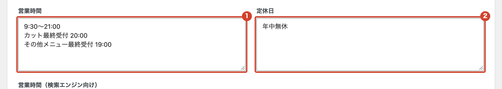
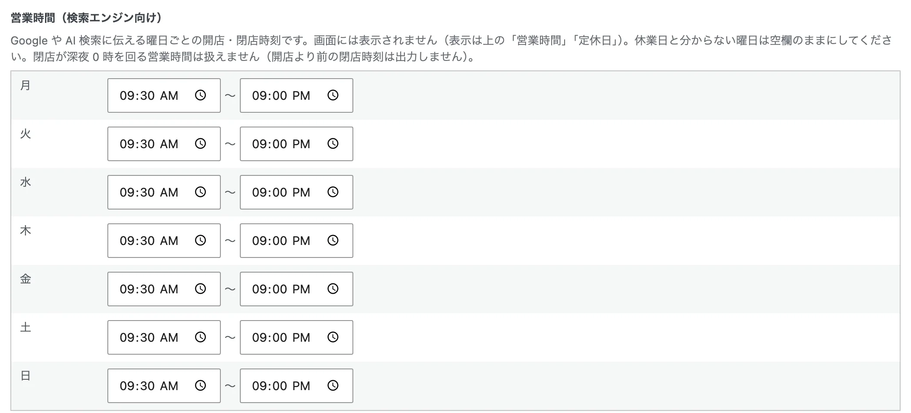

# 営業時間・定休日を変えたい

ホームページに出る営業時間と定休日を変えます。

<ol class="steps" markdown>
<li markdown="block">
左のメニューの「店舗情報・アクセス」を開きます。
</li>
<li markdown="block">
「営業時間」と「定休日」を書き換えます。ここに書いたとおりにホームページに出ます。

1. 営業時間
2. 定休日

{ .shot }
</li>
<li markdown="block">
すぐ下の「営業時間（検索エンジン向け）」も、曜日ごとに合わせて直します。Google などの検索に伝わる時間です。お休みの曜日は空欄にします。

{ .shot }
</li>
<li markdown="block">
いちばん下の「店舗基本情報を保存」を押します。

{ .shot }
</li>
</ol>

!!! note "注意"
    この画面の「座標を再取得」は押さないでください。押すと、保存していない変更が消えます。
