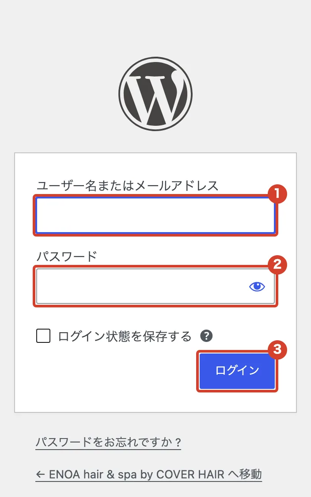
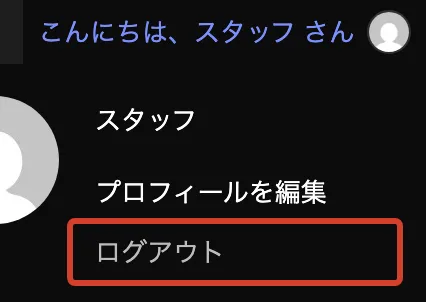

# ログインしたい

管理画面に入る方法と、終わるときの方法です。

## ログインする

<ol class="steps" markdown>
<li markdown="block">
[https://www.cover-s.jp/enoa/wp-login.php](https://www.cover-s.jp/enoa/wp-login.php) を開きます。ブックマークしておくと便利です。
</li>
<li markdown="block">
お送りしたユーザー名とパスワードを入れて、「ログイン」を押します。

1. ユーザー名
2. パスワード
3. 「ログイン」

{ .shot }
</li>
</ol>

## ログアウトする

右上の「こんにちは、〇〇 さん」にマウスをのせ、「ログアウト」を押します。共用のパソコンでは、終わったら必ずログアウトしてください。

{ .shot }
