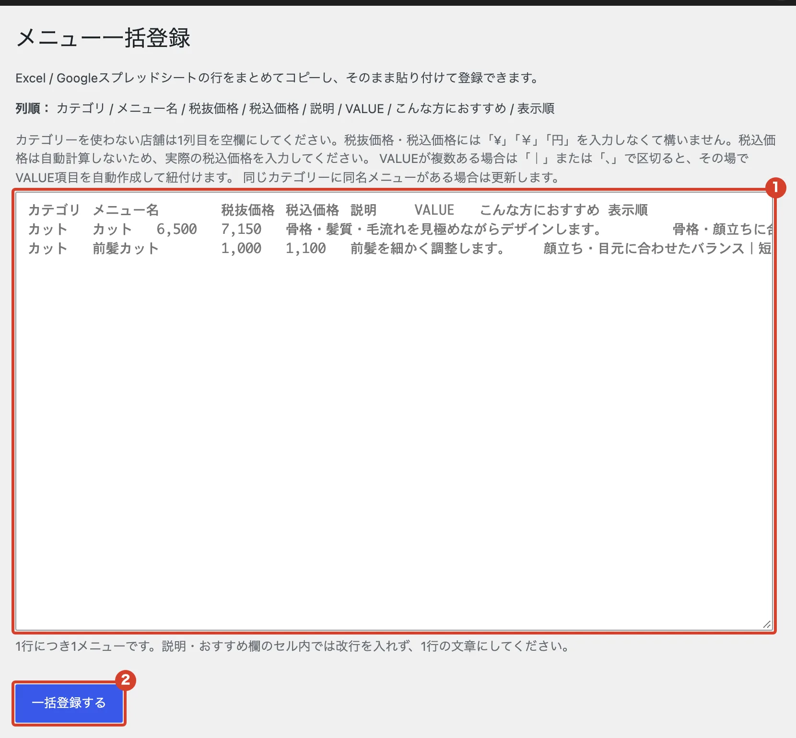

# メニューをまとめて登録したい

Excel や Google スプレッドシートの表から、メニューをまとめて登録・更新します。

<ol class="steps" markdown>
<li markdown="block">
表を、画面に書かれた列の順（カテゴリ、メニュー名、税抜価格、税込価格、説明、VALUE、こんな方におすすめ、表示順）に並べます。1 行が 1 メニューです。
</li>
<li markdown="block">
左のメニューで「メニュー」→「一括登録」を開きます。
</li>
<li markdown="block">
表の行をコピーして貼り付け、「一括登録する」を押します。

1. ここに貼り付けます。
2. 「一括登録する」

{ .shot }
</li>
</ol>

!!! note "注意"
    同じカテゴリーに同じ名前のメニューがあると、新しく作らずに上書きします。 
    説明などのセルの中では改行しないでください。
