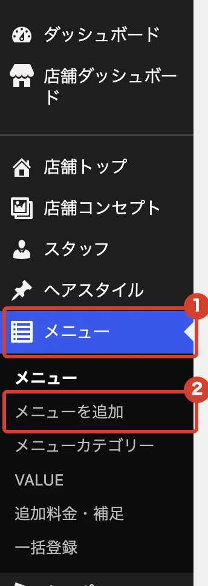
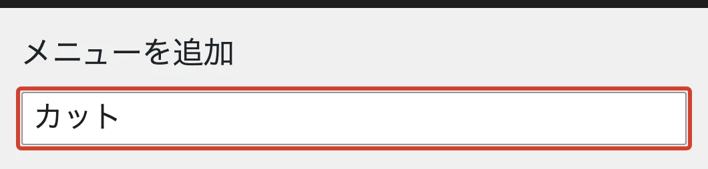
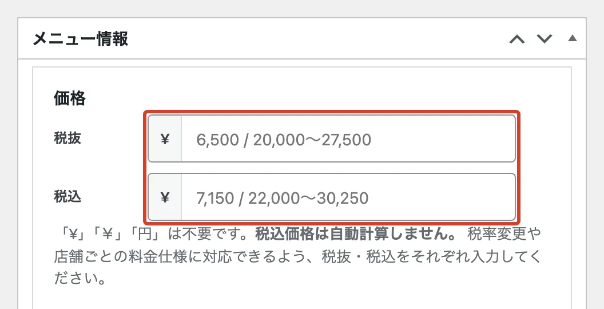
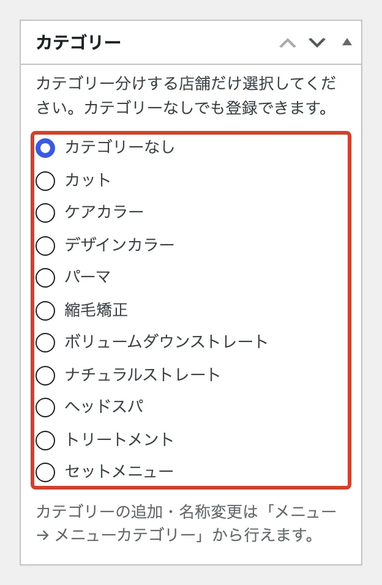
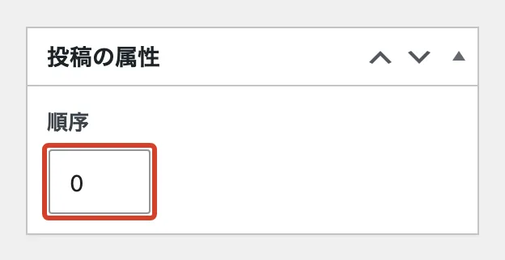
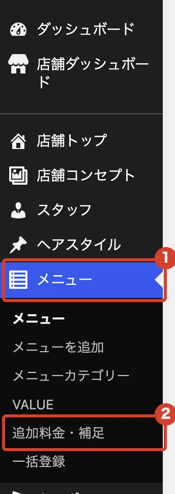
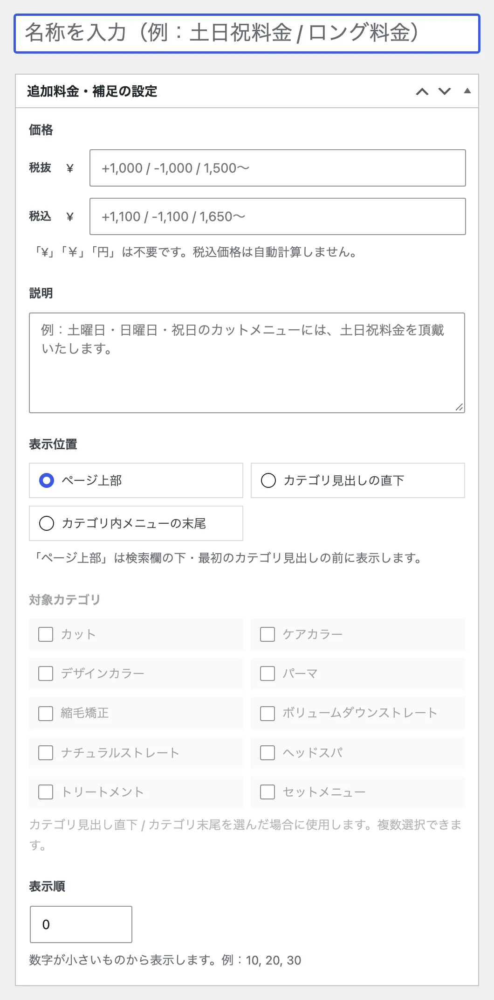

# メニューと料金を変えたい

ホームページの「メニュー」ページに出るメニューと料金を、追加・変更します。

## 新しく載せる

<ol class="steps" markdown>
<li markdown="block">
左のメニューで「メニュー」→「メニューを追加」を押します。

{ .shot }
</li>
<li markdown="block">
いちばん上の欄に、メニュー名を入れます。

{ .shot }
</li>
<li markdown="block">
税抜と税込の料金を入れます。**税込は自動で計算されません。** 両方入れてください。「¥」や「円」は不要です。説明などは空欄でもかまいません。

{ .shot }
</li>
<li markdown="block">
右側の「カテゴリー」で、カットやカラーなどを選びます。

{ .shot }
</li>
<li markdown="block">
「順序」に数字を入れます。同じカテゴリーの中で、小さい数字ほど上に並びます。10、20、30 のように間をあけておくと、あとで間に入れやすくなります。

{ .shot }
</li>
<li markdown="block">
右上の「公開」を押します。
</li>
</ol>

## 料金を直す

左のメニューの「メニュー」で一覧を開き、メニュー名を押します。直したら「更新」を押します。

## 追加料金や補足を載せる

「ロング料金」「土日祝料金」のような追加料金や補足は、「メニュー」→「追加料金・補足」で載せます。

{ .shot }

名前・料金・説明を入れ、「表示位置」を選んで「公開」を押します。「カテゴリ見出しの直下」などを選んだときは、「対象カテゴリ」にもチェックを入れます。

{ .shot }
