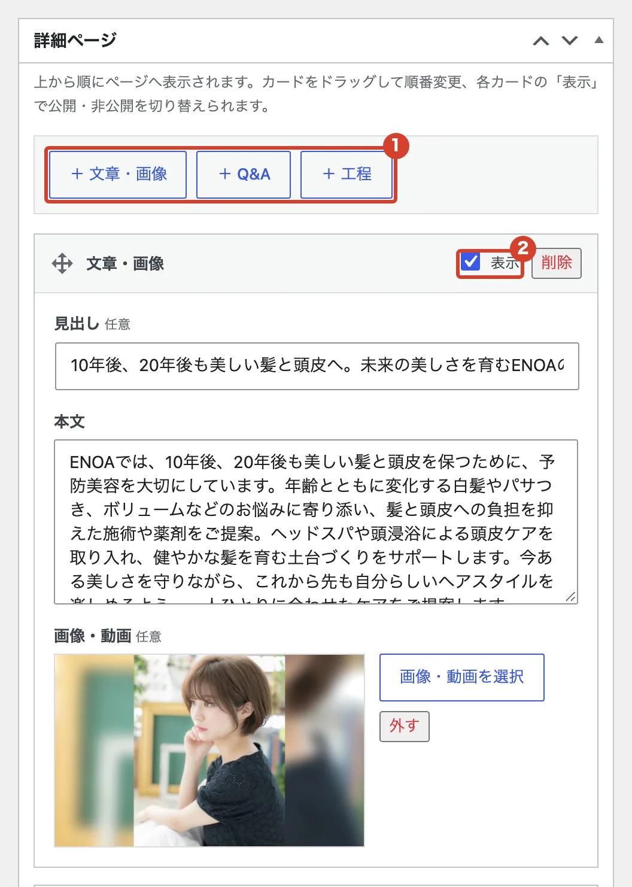
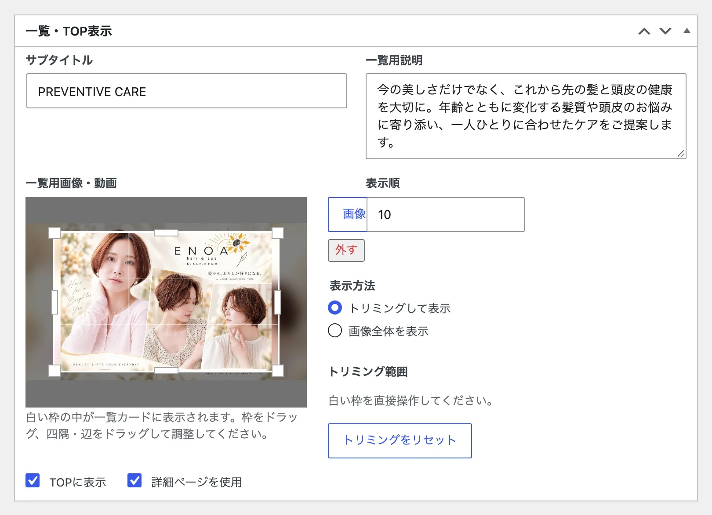
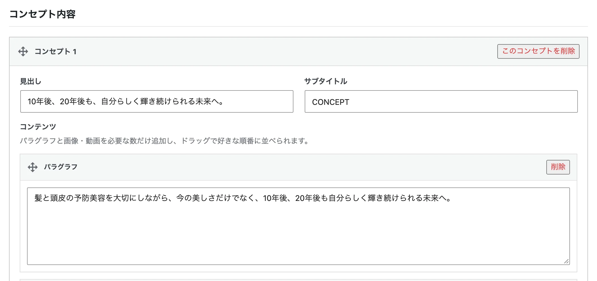
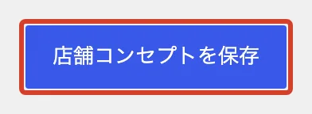

# 選ばれる理由・コンセプトを変えたい

「選ばれる理由」と「コンセプト」のページの文章や写真を変えます。

## 選ばれる理由

<ol class="steps" markdown>
<li markdown="block">
左のメニューの「選ばれる理由」で一覧を開き、直したい理由の名前を押します。
</li>
<li markdown="block">
「詳細ページ」で、文章や写真を直します。

1. 「＋ 文章・画像」などで、ブロックを足せます。
2. 「表示」を外したブロックは、ページに出なくなります。

{ .shot }
</li>
<li markdown="block">
「一覧・TOP表示」で、一覧や店舗トップに出る短い説明と写真を直します。

{ .shot }
</li>
<li markdown="block">
右上の「更新」を押します。
</li>
</ol>

## コンセプト

<ol class="steps" markdown>
<li markdown="block">
左のメニューの「店舗コンセプト」を開きます。
</li>
<li markdown="block">
「コンセプト内容」で、見出しや文章を直します。「＋ パラグラフを追加」「＋ 画像・動画を追加」で、文章や写真を足せます。

{ .shot }
</li>
<li markdown="block">
いちばん下の「店舗コンセプトを保存」を押します。

{ .shot }
</li>
</ol>
