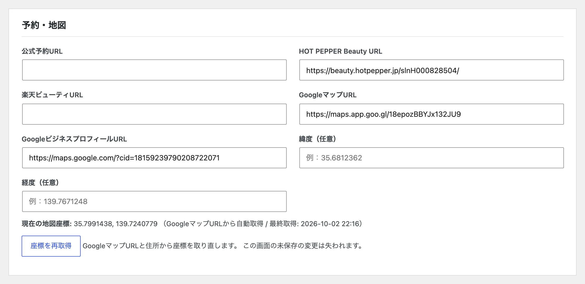
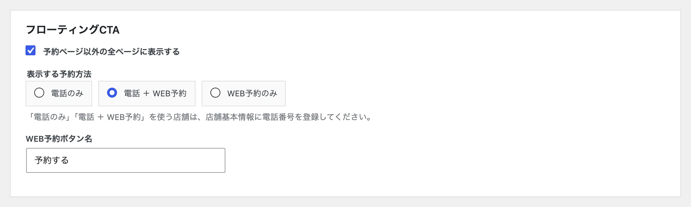
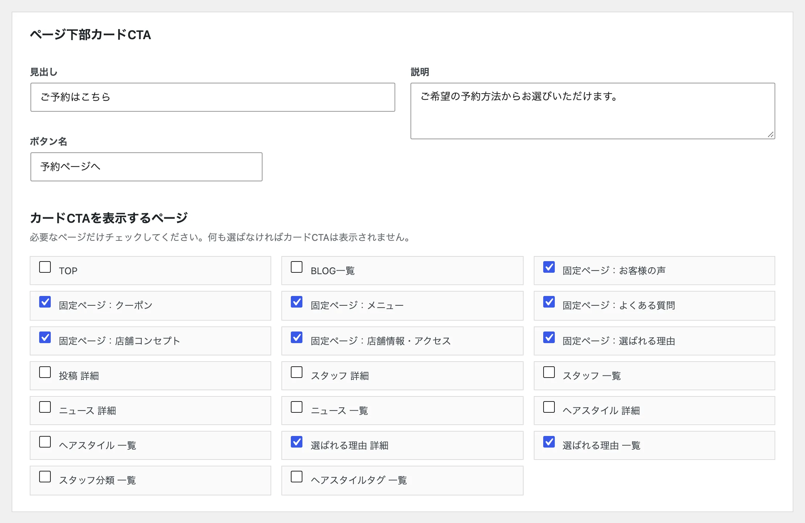
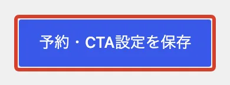

# 予約ボタンの設定を変えたい

予約ボタンの行き先と、画面に出る予約の案内を変えます。

## 予約先の URL を変える

<ol class="steps" markdown>
<li markdown="block">
左のメニューの「店舗情報・アクセス」を開きます。
</li>
<li markdown="block">
「予約・地図」で、予約サイトの URL を書き換えます。空欄にした予約方法は、ホームページに出なくなります。

{ .shot }
</li>
<li markdown="block">
いちばん下の「店舗基本情報を保存」を押します。
</li>
</ol>

## 予約の案内を変える

左のメニューの「ご予約・CTA」で変えます。終わったら、いちばん下の「予約・CTA設定を保存」を押します。

### 画面の下に出続ける予約ボタン

「フローティングCTA」で、出すかどうかと、電話・WEB予約のどちらを出すかを選びます。

{ .shot }

### ページの下の予約の案内

「ページ下部カードCTA」で、見出し・説明・ボタン名と、案内を出すページを選びます。

{ .shot }

{ .shot }
