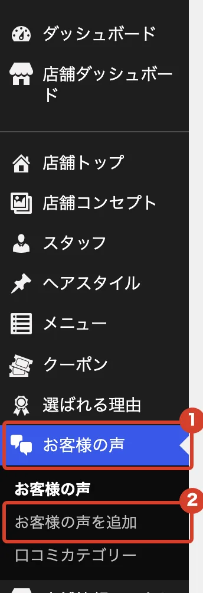
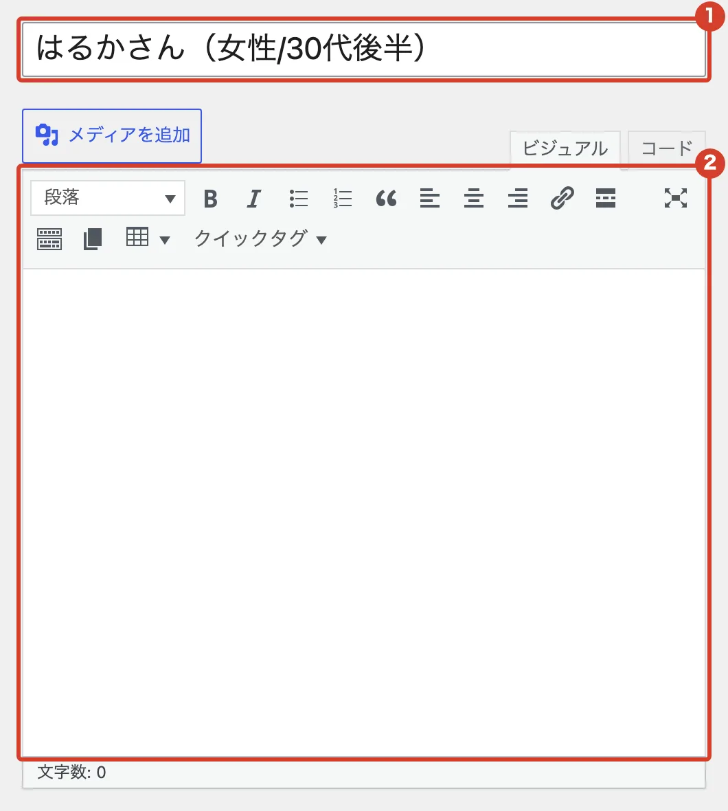
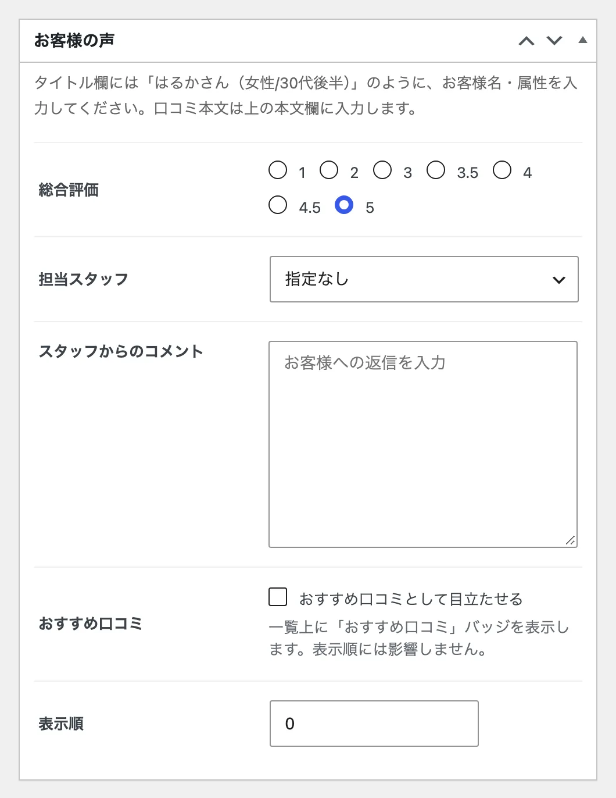
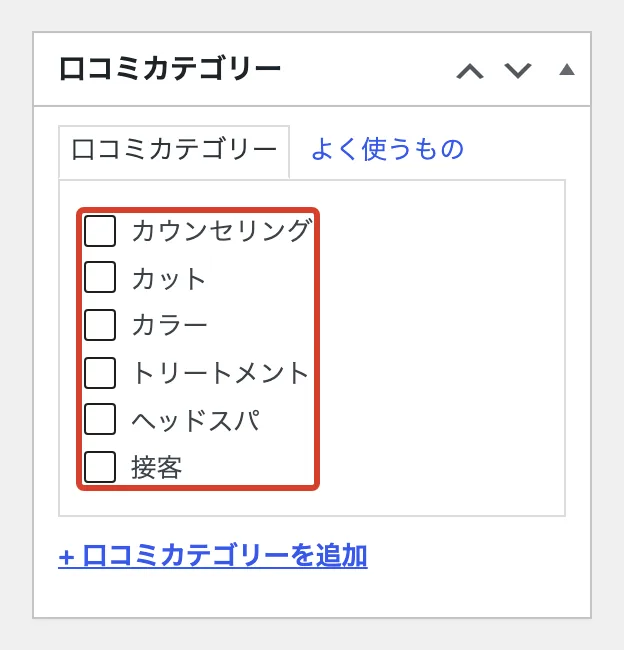

# お客様の声を載せたい

いただいた口コミを、ホームページの「お客様の声」に載せます。

<ol class="steps" markdown>
<li markdown="block">
左のメニューで「お客様の声」→「お客様の声を追加」を押します。

{ .shot }
</li>
<li markdown="block">
上の欄にお客様の呼び名、下の大きな欄に口コミの本文を入れます。

1. 「はるかさん（女性/30代後半）」のように書きます。
2. 口コミの本文

{ .shot }
</li>
<li markdown="block">
「お客様の声」の枠で、「総合評価」と「担当スタッフ」を選びます。「スタッフからのコメント」は空欄でもかまいません。「表示順」は、小さい数字ほど上に並びます。

{ .shot }
</li>
<li markdown="block">
右側の「口コミカテゴリー」で、当てはまるものにチェックを入れます。

{ .shot }
</li>
<li markdown="block">
右上の「公開」を押します。
</li>
</ol>
