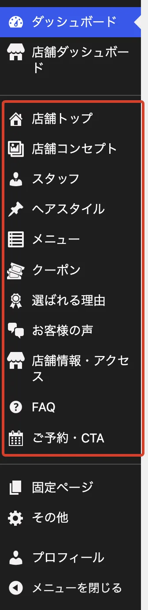
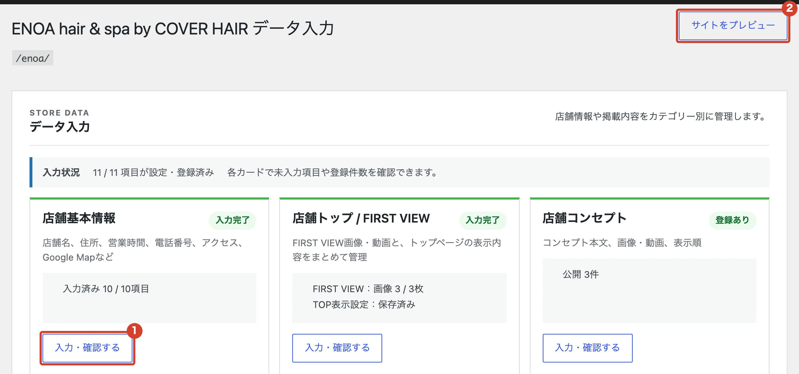

# 画面の見かたを知りたい

左のメニューと「店舗ダッシュボード」の使い方です。

## 左のメニュー

枠で囲んだ「店舗トップ」から「ご予約・CTA」までが、お店のホームページの中身です。ほかの項目は使いません。

{ .shot }

## 店舗ダッシュボード

左のメニューの「店舗ダッシュボード」を開くと、入力した内容の一覧が出ます。

<ol class="marks">
  <li>「入力・確認する」で、それぞれの画面を開きます。</li>
  <li>「サイトをプレビュー」で、ホームページの見え方を確かめます。</li>
</ol>

{ .shot }

!!! note "保存の前に見え方を確かめる"
    記事の画面では、右上の「プレビュー」（公開済みのものは「変更をプレビュー」）で、保存する前の見え方を確かめられます。
