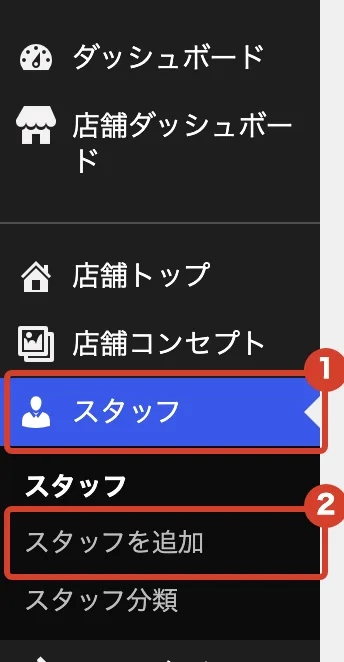
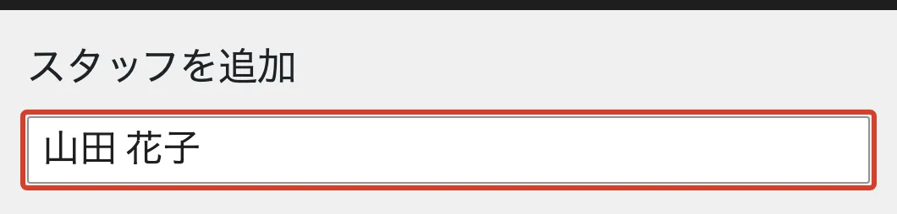
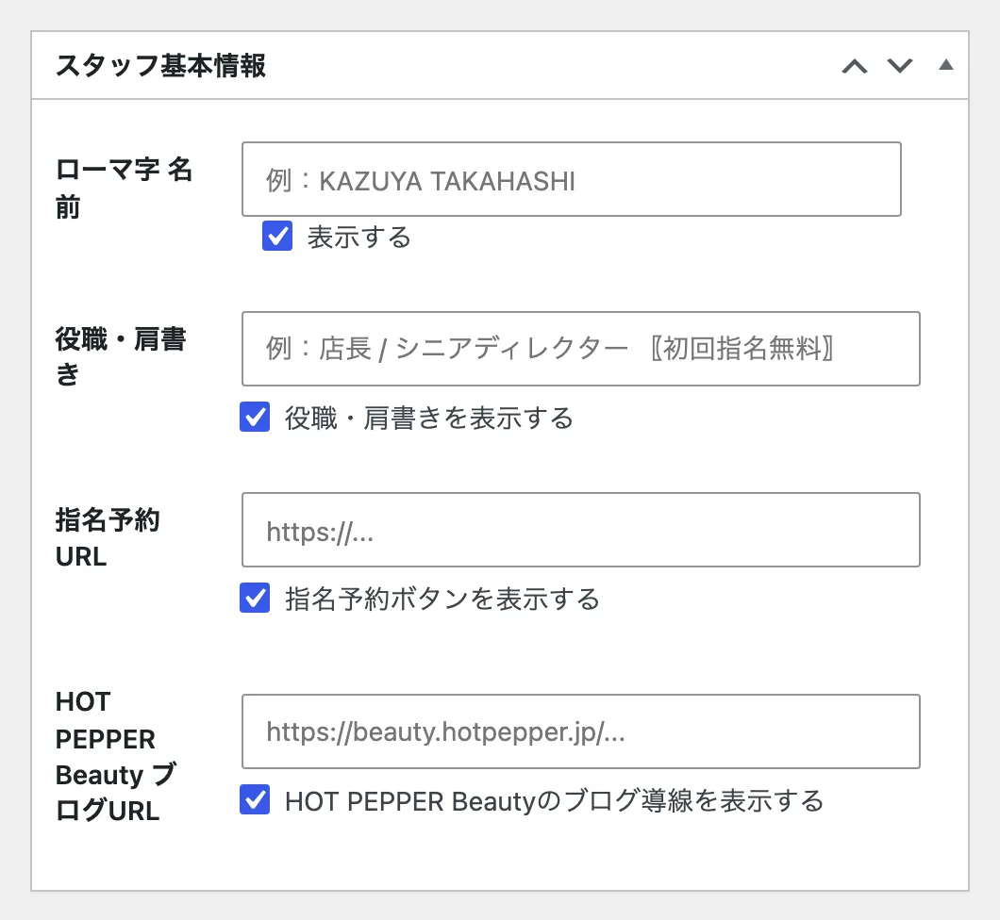
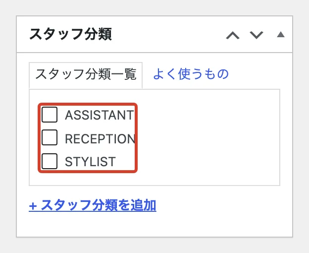
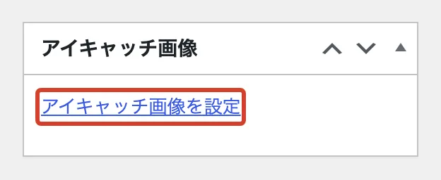
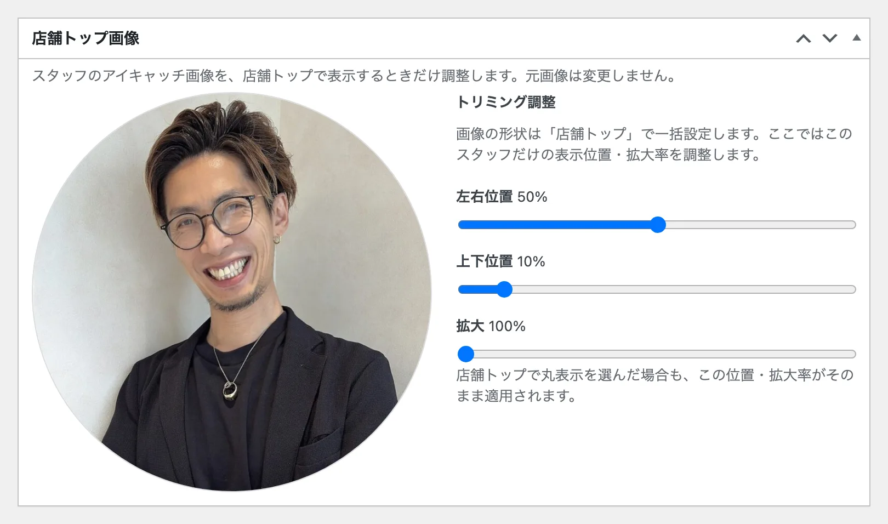

# スタッフを載せたい

スタッフの写真とプロフィールを、ホームページの「スタッフ」に載せます。

## 新しく載せる

<ol class="steps" markdown>
<li markdown="block">
左のメニューで「スタッフ」→「スタッフを追加」を押します。

{ .shot }
</li>
<li markdown="block">
いちばん上の欄に、名前を入れます。

{ .shot }
</li>
<li markdown="block">
「スタッフ基本情報」に、ローマ字の名前や役職を入れます。分からない欄は空欄でかまいません。

{ .shot }
</li>
<li markdown="block">
右側の「スタッフ分類」で、STYLIST などを選びます。**選ばないと、スタッフの一覧に出ません。**

{ .shot }
</li>
<li markdown="block">
右下の「アイキャッチ画像を設定」を押して、写真を選びます。選び方は[ヘアスタイル](style.md)と同じです。

{ .shot }
</li>
<li markdown="block">
右上の「公開」を押します。

{ .shot }
</li>
</ol>

!!! note "入れなくてよいもの"
    「Staff Detail」のコメントやプロフィールは、書いた項目だけがページに出ます。空欄の項目は出ません。 
    「SEO設定」は触らないでください。

## 店舗トップでの写真の位置を変える

公開したあと、同じ画面の「店舗トップ画像」で、店舗トップに出る写真の位置と大きさを変えられます。動かしたら「更新」を押します。

{ .shot }
