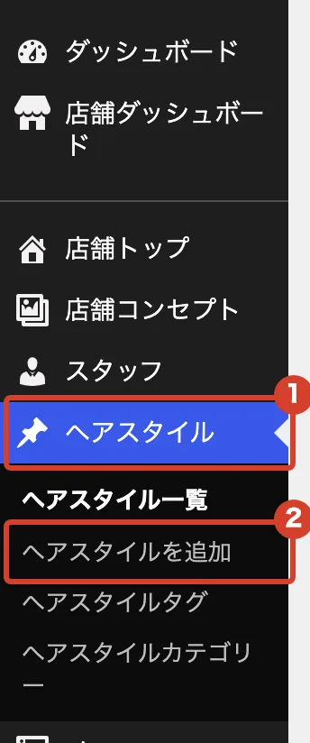
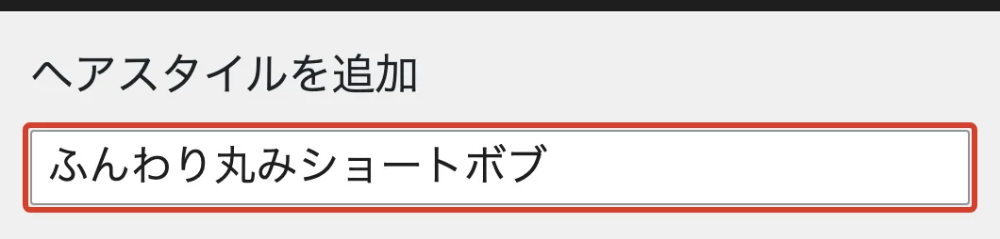
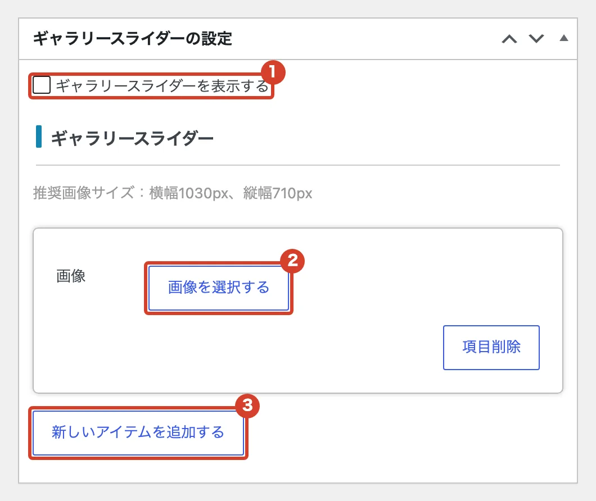
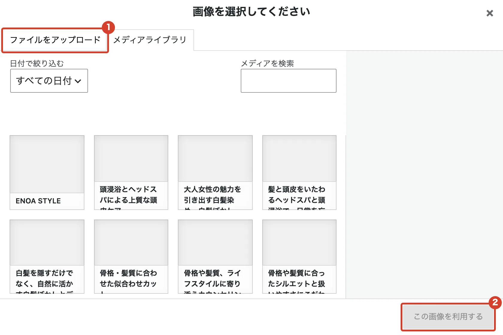
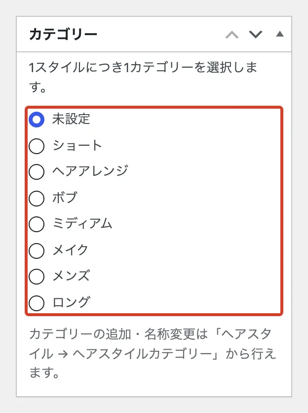
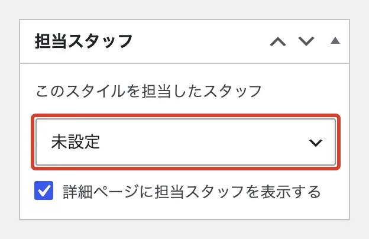
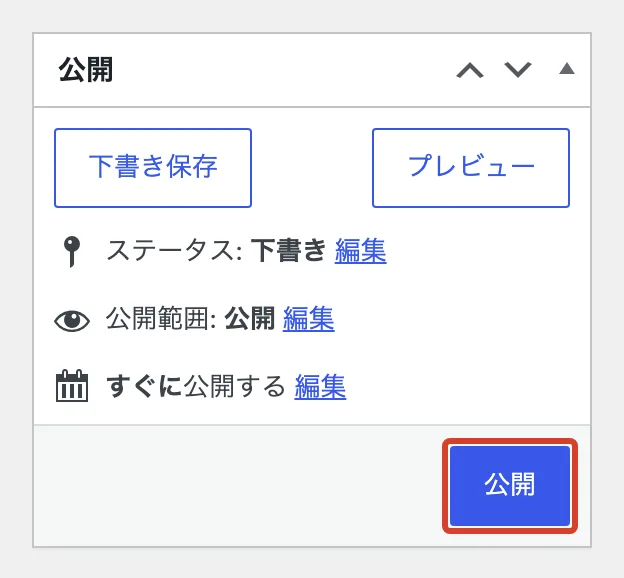
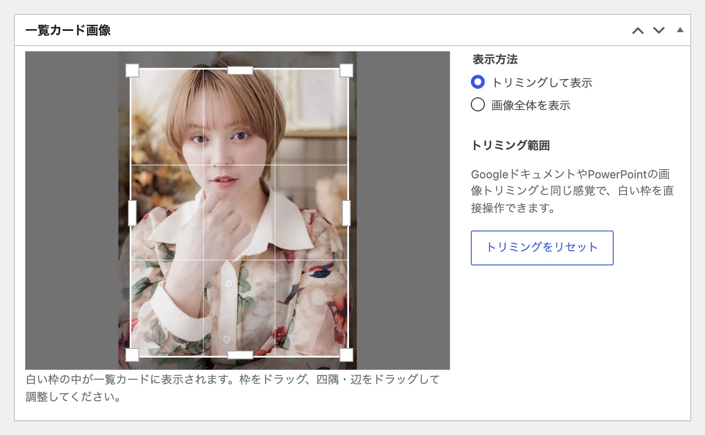
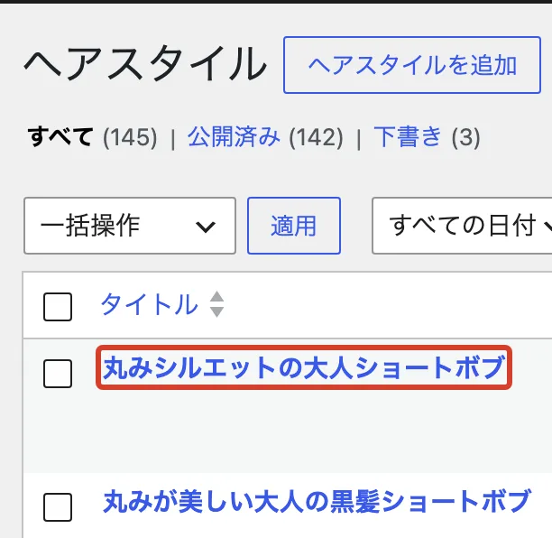

# ヘアスタイルを載せたい

スタイル写真を、ホームページの「ヘアスタイル」に載せます。

## 新しく載せる

<ol class="steps" markdown>
<li markdown="block">
左のメニューで「ヘアスタイル」→「ヘアスタイルを追加」を押します。

{ .shot }
</li>
<li markdown="block">
いちばん上の欄に、スタイルの名前を入れます。

{ .shot }
</li>
<li markdown="block">
「ギャラリースライダーの設定」で写真を入れます。

1. 「ギャラリースライダーを表示する」にチェックが入っていることを確かめます。**外すと写真が出ません。**
2. 「画像を選択する」を押します。
3. 2 枚目からは「新しいアイテムを追加する」を押してから選びます。

{ .shot }
</li>
<li markdown="block">
「ファイルをアップロード」でパソコンの写真を選び、「この画像を利用する」を押します。

{ .shot }
</li>
<li markdown="block">
右側の「カテゴリー」で、長さを 1 つ選びます。

{ .shot }
</li>
<li markdown="block">
「担当スタッフ」で担当した人を選びます。

{ .shot }
</li>
<li markdown="block">
右上の「公開」を押すと、ホームページに載ります。

{ .shot }
</li>
</ol>

!!! note "入れなくてよいもの"
    「ヘアスタイル詳細情報」（カラー・イメージなど）は空欄でもかまいません。 
    「カスタムCSS」「ギャラリーページの設定」「meta title と meta description」「SEO設定」は触らないでください。

## 一覧に出る範囲を変える

公開したあと、同じ画面の「一覧カード画像」に写真が出ます。白い枠を動かして、一覧に出す範囲を決め、「更新」を押します。

{ .shot }

## 載せたスタイルを直す

「ヘアスタイル」の一覧で名前を押すと、さきほどと同じ画面が開きます。直したら「更新」を押します。

{ .shot }
