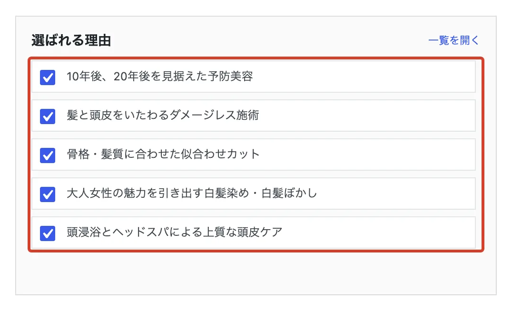
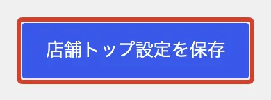
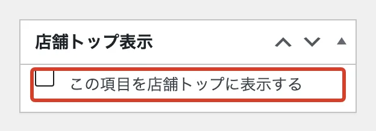
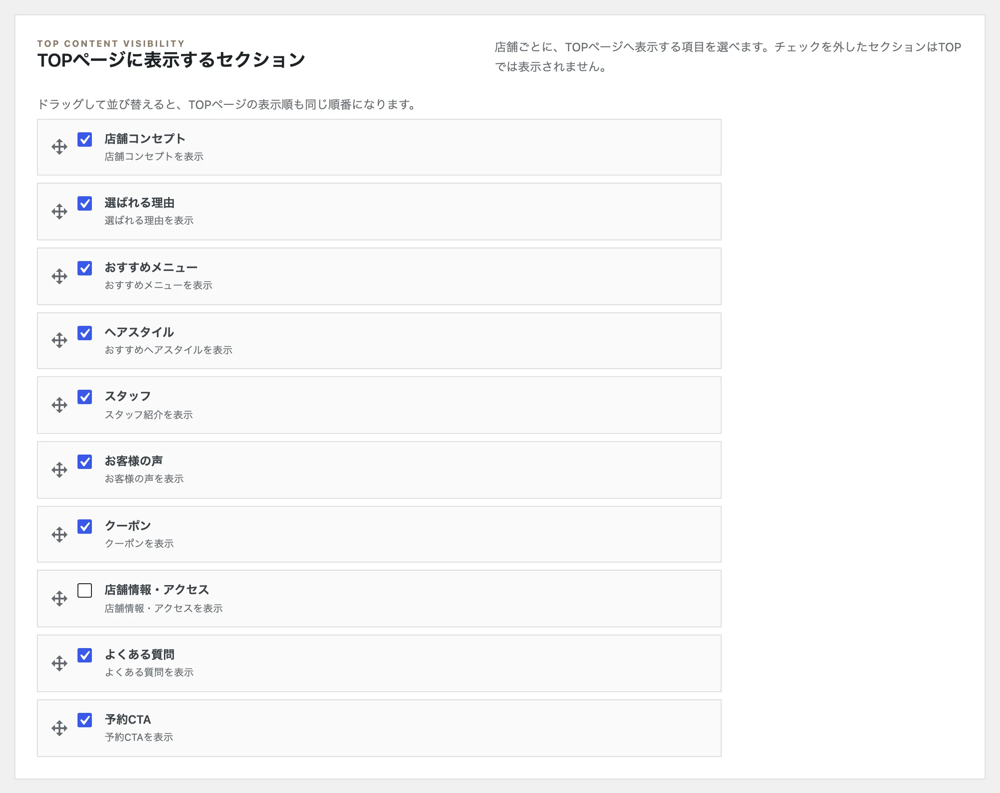

# 店舗トップに載せるものを選びたい

店舗トップ（ホームページの最初のページ）に出すスタイルやメニューなどを選びます。

## 店舗トップの画面で選ぶ

<ol class="steps" markdown>
<li markdown="block">
左のメニューの「店舗トップ」を開きます。
</li>
<li markdown="block">
「TOPページに表示する内容」で、載せたいものにチェックを入れます。チェックしたものが、上から順に店舗トップに並びます。

{ .shot }
</li>
<li markdown="block">
いちばん下の「店舗トップ設定を保存」を押します。

{ .shot }
</li>
</ol>

!!! note "並び順"
    新しくチェックしたものは、いちばん最後に並びます。

## 記事の画面で選ぶ

ヘアスタイル・スタッフ・クーポン・お客様の声・選ばれる理由は、それぞれの編集画面の右下にある「店舗トップ表示」でも選べます。チェックを入れて「公開」か「更新」を押します。

{ .shot }

## コーナーごと隠す・並べ替える

「TOPページに表示するセクション」で、チェックを外したコーナーは店舗トップに出なくなります。左のつまみをドラッグすると、並び順を変えられます。最後に「店舗トップ設定を保存」を押します。

{ .shot }
