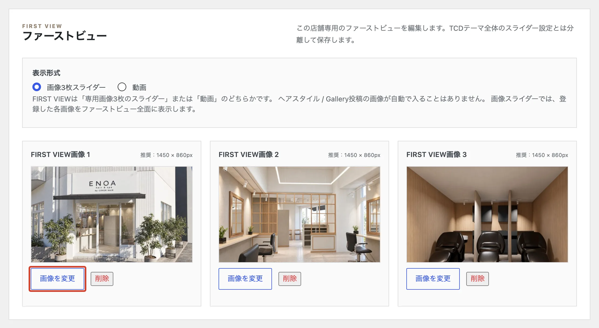

# 店舗トップの写真を変えたい

店舗トップのいちばん上に大きく出る 3 枚の写真を変えます。

<ol class="steps" markdown>
<li markdown="block">
左のメニューの「店舗トップ」を開きます。
</li>
<li markdown="block">
「ファーストビュー」で、変えたい写真の「画像を変更」を押して、写真を選びます。横長の写真（横 1450 × 縦 860 くらい）がきれいに出ます。

{ .shot }
</li>
<li markdown="block">
いちばん下の「店舗トップ設定を保存」を押します。

{ .shot }
</li>
</ol>
