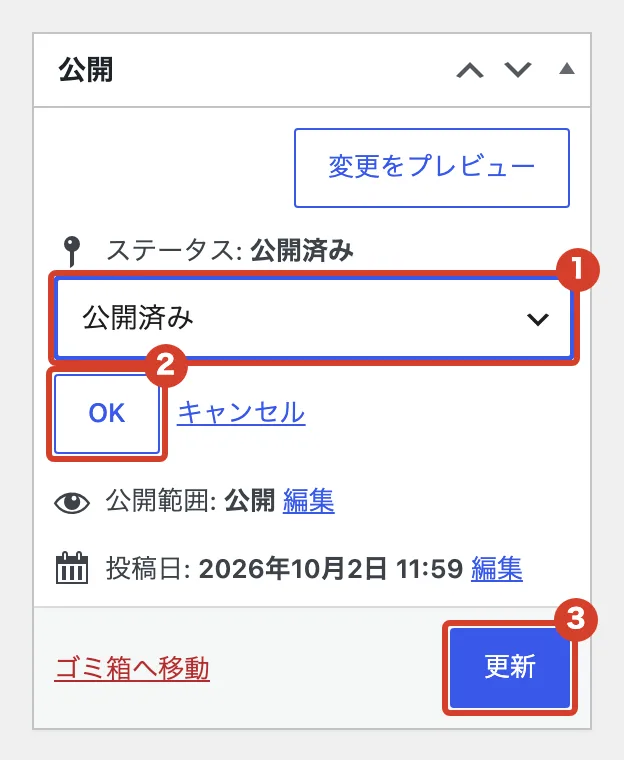
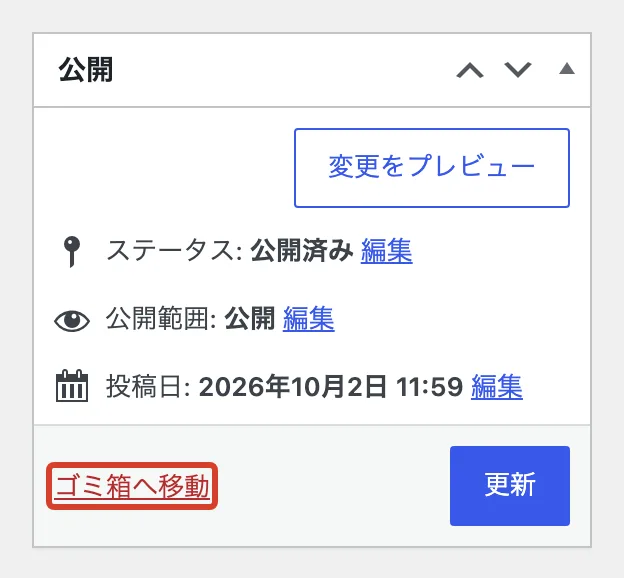
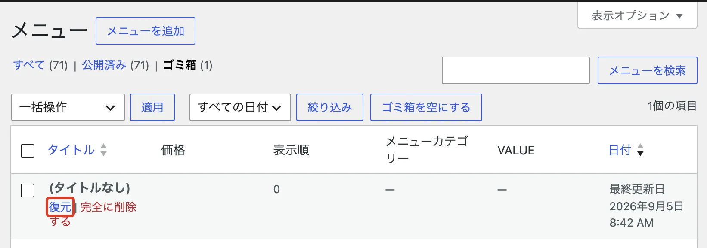

# 載せたものを消したい

ホームページから一時的に隠す方法と、削除する方法です。ヘアスタイル・スタッフ・メニュー・クーポン・お客様の声で同じ手順です。

## 一時的に隠す（下書きに戻す）

あとでまた載せる予定があるときは、こちらを使います。

<ol class="steps" markdown>
<li markdown="block">
一覧で名前を押して、編集の画面を開きます。
</li>
<li markdown="block">
右上の「公開」の枠で、「ステータス」の横の「編集」を押します。

1. 「下書き」を選びます。
2. 「OK」を押します。
3. 「更新」を押します。

{ .shot }
</li>
</ol>

もう一度載せるときは、同じ画面で「公開」を押します。

## 削除する

同じ枠の「ゴミ箱へ移動」を押します。

{ .shot }

## 間違えて削除したとき

一覧の上の「ゴミ箱」を開き、名前にマウスをのせて「復元」を押します。復元したものは下書きに戻るので、もう一度「公開」を押します。

{ .shot }
